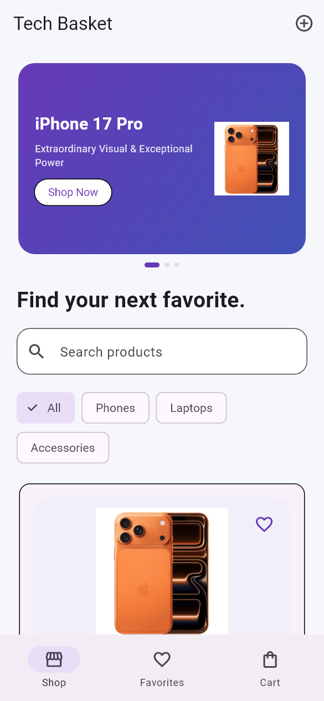

# Tech Basket

## Description

Tech Basket is a Flutter shopping demo for browsing electronics and managing a personal cart. It includes product search, category filters, favorites and a form for adding products with images. Saved products, favorites and cart items are stored locally on the device.

## Preview



Mobile preview at 390 × 844 logical pixels.

## Features

- Browse an electronics catalog with product images and prices.
- Search products and filter them by category.
- Add or remove favorite products.
- Add products to the cart, change quantities and view the total.
- Create a product with an image and a validated positive price.
- Save custom products, favorites and cart items using SharedPreferences.
- Try a demo checkout flow.

## Built with

Flutter, Dart, Material 3, StatefulWidget, setState and Navigator. image_picker and shared_preferences.

The code uses straightforward widgets and small methods so it is easy to follow and extend. The existing Dart package name remains `ecommerce`.

## Run locally

Use Flutter 3.47.5 / Dart 3.13.4 or a compatible newer SDK.

```bash
git clone https://github.com/YOUR_USERNAME/tech-basket.git
cd tech-basket
flutter pub get
flutter run
```

Run `flutter pub get` after changing Flutter versions to regenerate local package metadata. Choose a connected Android device, iOS simulator on macOS, or another supported target with `flutter devices`.

## Checks

```bash
flutter analyze
flutter test
```

## Project structure

- `lib/main.dart`: app entry point.
- `lib/ui.dart`: theme and introductory card.
- `lib/`: screens and small project-specific components.
- `test/`: smoke and behavior tests.
- `android/`, `ios/`, `web/`: platform scaffolding where generated.

## Limitations

- Checkout is a demonstration; no payment or real order is processed.
- There is no backend, authentication or synchronization between devices.
- SharedPreferences storage is intended for a small demo catalog.
- Each custom product image is limited to 1 MB.
- Clearing app data removes locally saved products, favorites and cart items.
- Image selection on native devices and signed release builds have not been verified.

## Validation

Checked locally with Flutter 3.47.5 / Dart 3.13.4: analysis and tests pass. Mobile previews were captured with Flutter widget rendering. Native device behavior and signed release builds have not been verified.

A small GitHub Actions workflow runs formatting, analysis and tests on pushes and pull requests. It will run after this repository is uploaded.

## License and assets

No open-source license has been selected. Existing bundled artwork is retained; verify your right to redistribute it before choosing a license. Character artwork and data, where applicable, belong to their respective owners.
